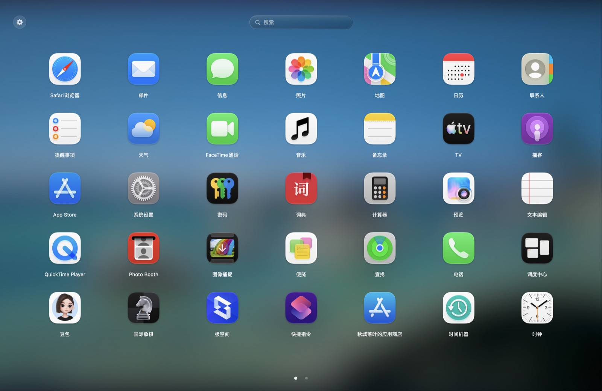
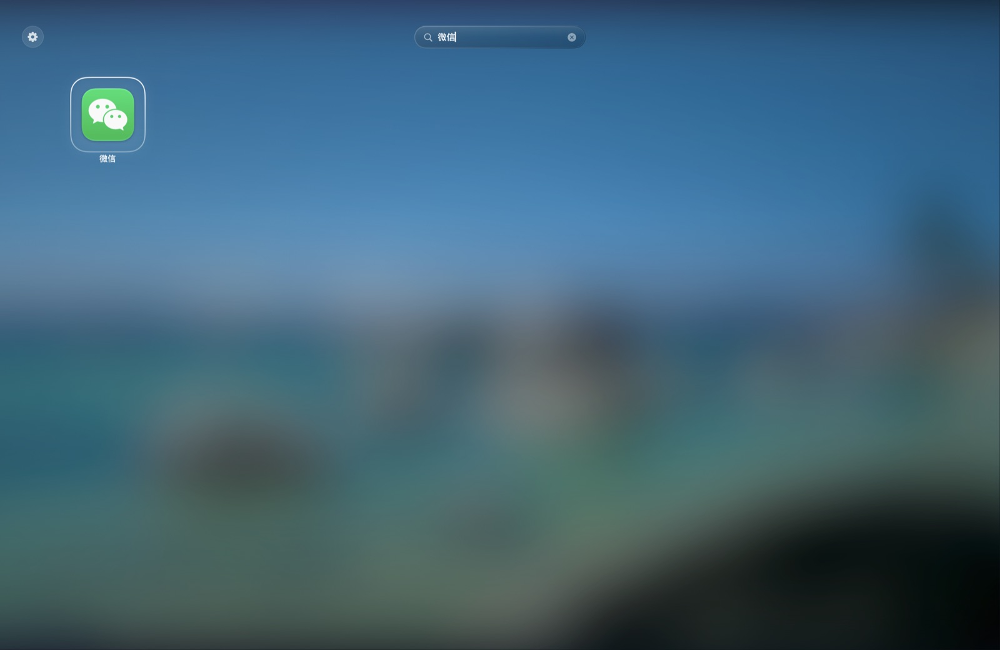
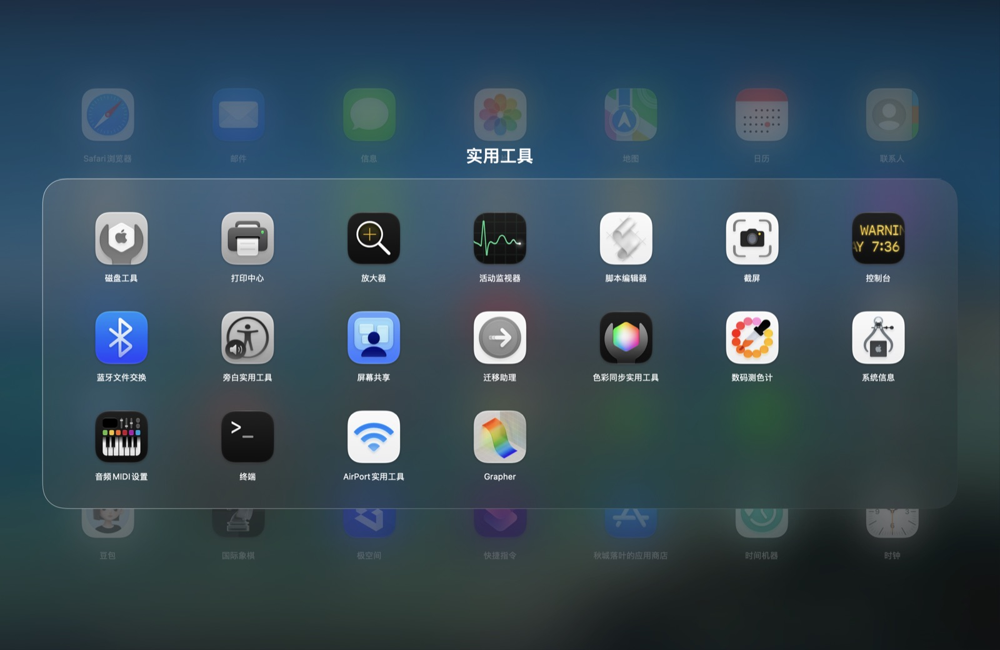
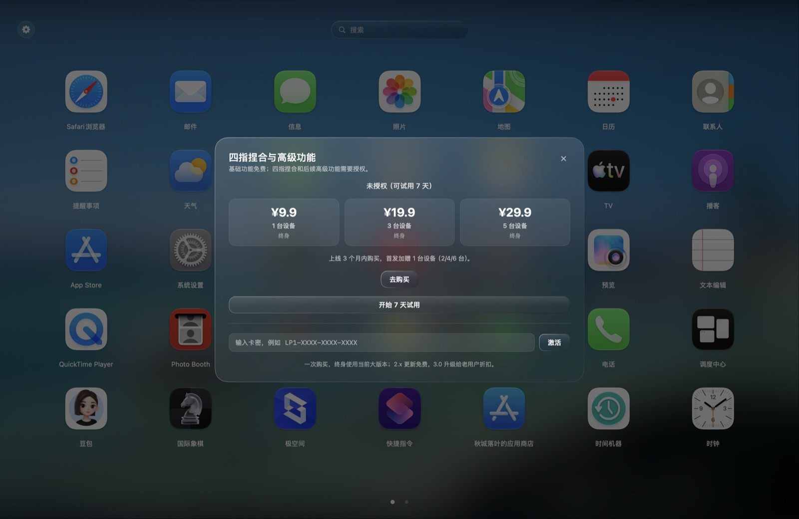
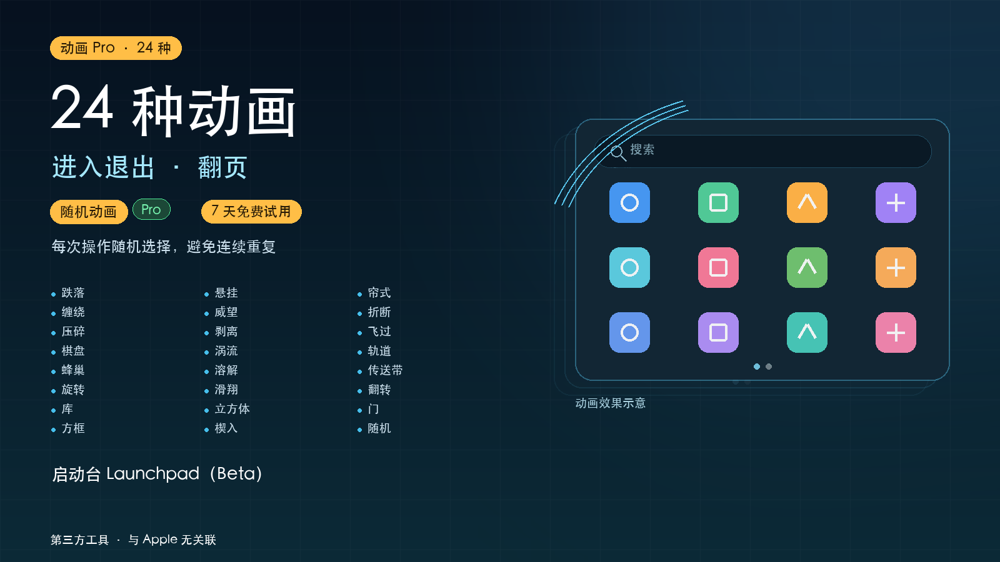

# 启动台 · Launchpad for macOS 26（Beta）

> 当前最新：**2.2 build 56**

一个独立实现的 macOS 启动台（Launchpad）应用。AppKit + SwiftUI 编写，适配 **macOS 26.0 及以上**。

> 当前为 **Beta 版本**，功能和稳定性仍在完善；四指捏合依赖 macOS 私有触控板接口，系统更新后可能失效。建议先使用 7 天试用确认可用后再购买。

## 功能

- 全屏启动台，覆盖菜单栏与 Dock，自动显示在鼠标所在屏幕
- 应用网格、搜索、分页、页码点
- 中文、英文、拼音、首字母、Bundle ID 搜索
- 文件夹：创建、重命名、拖拽排序、拖出移出、单应用自动解散
- 编辑模式：长按抖动、拖拽排序、停留 600ms 建文件夹、边缘自动翻页
- 四指捏合：收拢打开、张开退出（需授权）
- 24 种进入/退出与翻页动画，支持“随机动画”（需授权）
- 菜单「动画」和「四指捏合」带绿色 Pro 标识
- 菜单栏常驻：显示/隐藏、隐藏菜单栏图标、开机自启动、检查更新、帮助
- 桌面壁纸毛玻璃背景（含动态壁纸）
- 新安装应用自动出现，卸载后自动移除

| 搜索 | 文件夹 |
| --- | --- |
|  |  |

| 编辑模式 | 购买 / 授权 |
| --- | --- |
|  |  |

## 动画

进入退出和翻页都支持 24 种动画：跌落、悬挂、帘式、缠绕、威望、折断、压碎、剥离、飞过、棋盘、涡流、轨道、蜂巢、溶解、传送带、旋转、滑翔、翻转、库、立方体、门、方框、楔入，以及「随机动画」。

## 系统要求

- macOS 26.0 或更高版本
- Apple Silicon（arm64）/ Intel（x86_64）
- 四指捏合需要“输入监控”权限

## 下载

- 下载页：<https://download.luyfapp.cn>
- GitHub Releases：<https://github.com/luyfapp/Launchpad/releases/tag/v2.2-build56>
- 最新 DMG：<https://download.luyfapp.cn/Launchpad-latest.dmg>

## 安装

1. 下载 DMG；
2. 打开 DMG，把 **Launchpad** 拖进 Applications；
3. 首次打开若被 Gatekeeper 拦截：右键应用 → **打开**；
4. 按提示授予“输入监控”权限（四指捏合需要）。

当前为 ad-hoc 签名、未公证，因此首次打开需要右键确认。

## 试用与授权

- 首次开启四指捏合可免费试用 **7 天**；
- 试用到期后，通过卡密激活；
- 授权绑定设备，支持 1/3/5 台档位；
- 30 天内可解绑 1 次；
- 一次购买，终身使用当前 2.x 大版本；后续 3.0 升级给老用户折扣。

菜单栏 → **购买 / 授权…** 可查看试用、激活、解绑。

## 更新

菜单栏 → **检查更新…** 会读取：

<https://download.luyfapp.cn/update.json>

发现新版本后会显示更新说明和下载按钮；下载新 DMG 覆盖安装即可，授权与试用状态保留。

## Beta 说明

- 当前是 Beta，可能存在缺陷、兼容性问题或界面调整；
- 四指捏合使用 `MultitouchSupport` 私有框架，macOS 大版本更新后可能失效；
- 未做 Apple 公证，首次打开需要右键；
- 购买即表示理解并接受 Beta 风险。

## 已知限制

- 不适合提交 Mac App Store；
- 系统“App / 显示桌面”四指手势会与启动台冲突，需要在 系统设置 → 触控板 → 更多手势 中关闭；
- 应用不上传应用列表、搜索内容、文件路径或触控轨迹。

## 支持

- 邮箱：386701036@qq.com
- GitHub：https://github.com/luyfapp
- 问题反馈请附：macOS 版本、App build、复现步骤、截图/录屏。

## 版权

Copyright © 2026 luyfapp. All rights reserved.

本仓库仅用于产品介绍、下载与问题反馈，不包含源代码。Apple、macOS、Launchpad 是 Apple Inc. 的商标；本项目与 Apple 无关联。
